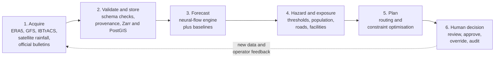
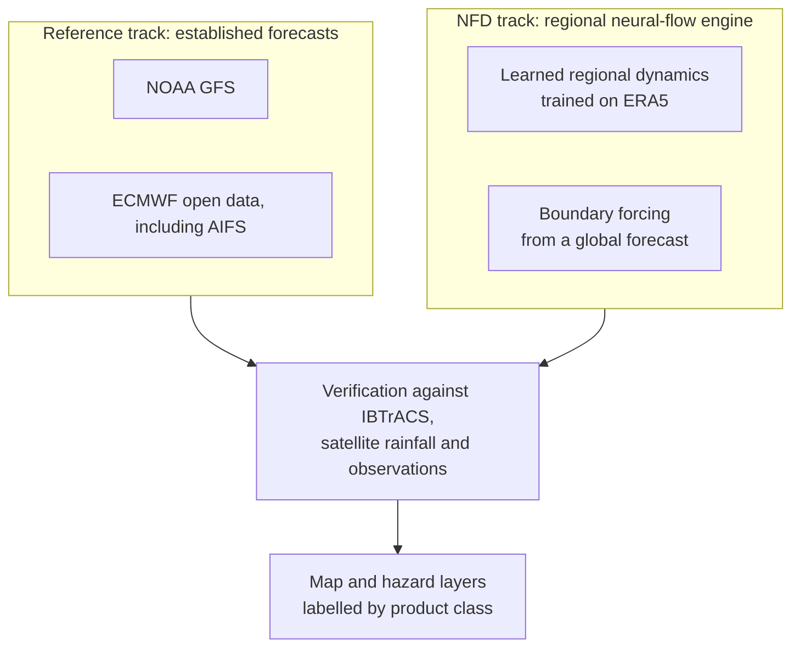
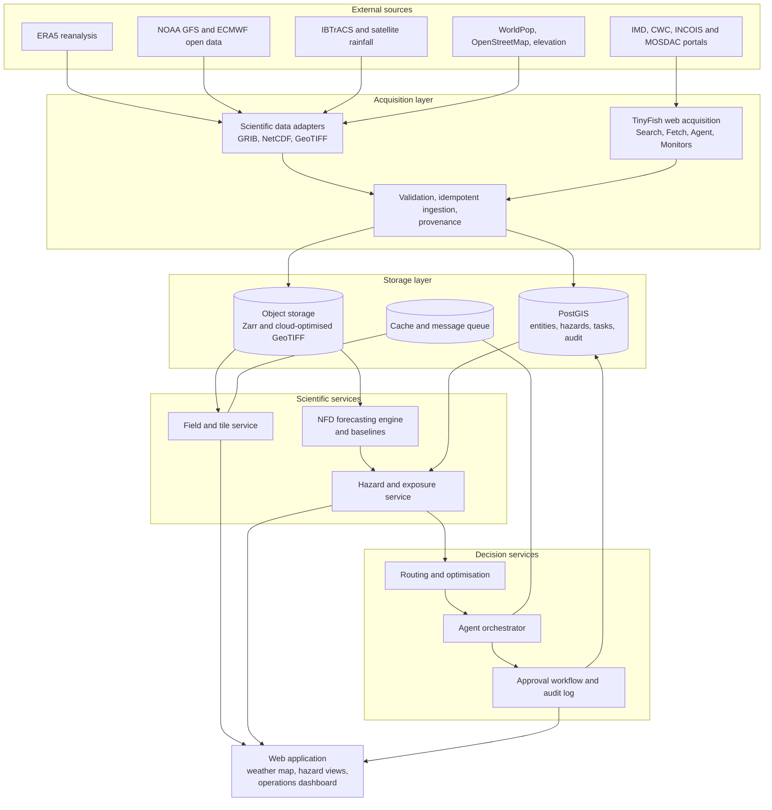
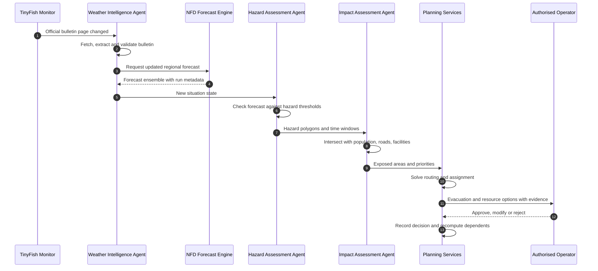
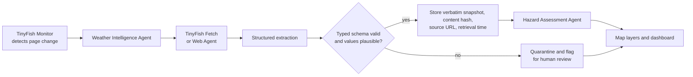
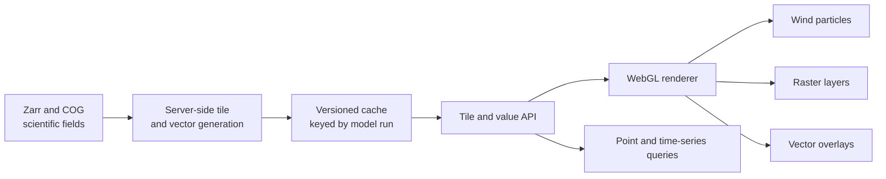
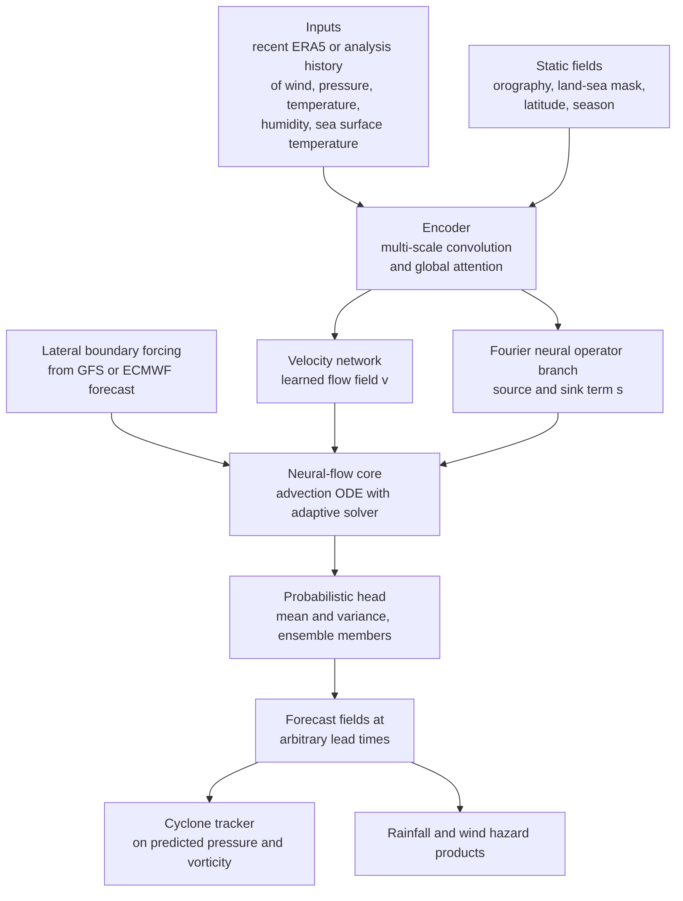
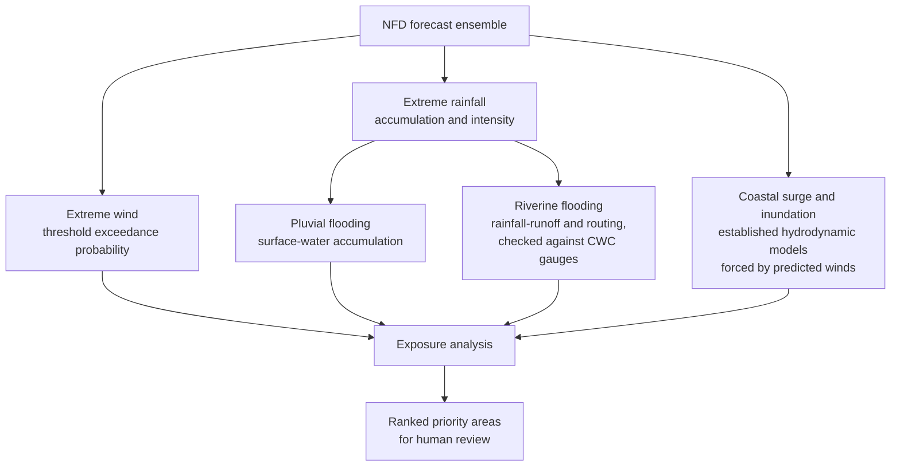
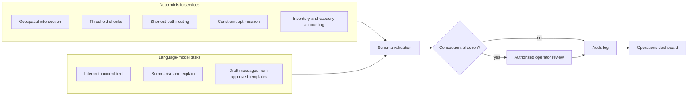
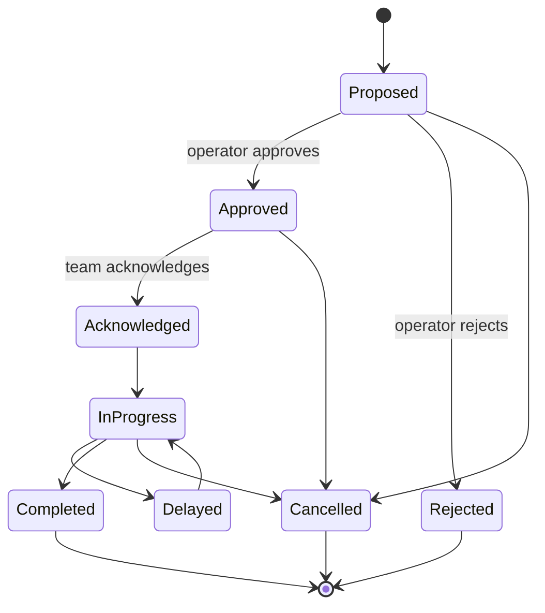

# Neural Flow Dynamics

**A research platform for weather forecasting and disaster decision support in India.**

Neural Flow Dynamics (NFD) is intended to connect environmental data, regional forecasting research, geospatial hazard analysis, and human-reviewed disaster planning.

## Implementation status

The repository scaffold, local runtime configuration, initial data contracts, source feasibility checks, and source-independent ingestion core are implemented. The architecture and capability descriptions below are **plans, not implemented or verified features**. There is currently no live weather map, source-specific weather-data adapter, forecast model, official warning feed, hazard or exposure service, operational agent, or response-planning system. No real weather arrays or model results are included.

| Area | Status |
|---|---|
| Repository scaffold | Complete (Step 0.1) |
| Local runtime configuration and health endpoint | Implemented; Compose startup unverified because Docker is unavailable (Step 0.2) |
| Initial backend and frontend contract types | Implemented; JSON Schema export remains (Step 0.3) |
| Data-source access and licensing | Partially verified (Step 0.4; see source_registry.json) |
| Ingestion core | Implemented and tested; provider adapters remain (Step 1.1) |
| Weather-data API and map | Health endpoint only; data API and map not implemented |
| Forecasting, hazards, and exposure | Not implemented |
| Planning, agents, and operations UI | Not implemented |

### Source feasibility snapshot (2026-10-15)

The registry is in [`source_registry.json`](source_registry.json). Checks can be
rerun from `backend/` with `uv run python -m app.source_feasibility`. TinyFish
is only called when `--probe-tinyfish` is explicitly supplied and an
`TINYFISH_API_KEY` is present; the key is never printed.

| Source | Observed result | Remaining caveat |
|---|---|---|
| ARCO-ERA5 | Anonymous GCS metadata and variable attributes responded. Stable coverage ends 2026-06-30; ERA5T ends 2026-10-09. Core wind, pressure, precipitation, temperature, SST, and geopotential variables were found. | Metadata only; no arrays downloaded. ERA5T is preliminary, and precipitation accumulation semantics still need a focused data check. |
| NOAA GFS `noaa-gfs-bdp-pds` | Anonymous S3 listing succeeded; current and prior UTC date prefixes each contained a run object. | This does not prove all forecast lead files are complete or verify the required GRIB parameters. |
| NOAA GFS `noaa-gfs-pds` | Anonymous listing returned zero keys. | Do not use this candidate bucket. |
| IBTrACS North Indian v04r01 | Official CSV URL responded with HTTP 200 and a 27,886,424-byte content length. | Direct file/header probe is included in the checker; preserve blank missing values and agency distinctions. |
| NDMA SACHET | `/CapFeed` is reachable but is an HTML subscription page; visible RSS links loop back to that page. | Exact feed URL and reuse terms remain unresolved; no guessed feed is used. |
| TinyFish Fetch | Official docs confirm `POST https://api.fetch.tinyfish.ai`, `X-API-Key`, maximum 10 URLs, and a documented daily free allowance. | No API key is configured, so no live API call was made. |
| OpenStreetMap | Official licensing page confirms ODbL and attribution requirements. | No study-area extract selected; OSM tile/API use has separate policies. |
| WorldPop | The official site describes open demographic data and an API; this environment's direct catalog probe returned HTTP 403. | Specific India file, year, resolution, access route, and license remain unverified. |

## Local development

Install Docker Desktop, then copy `.env.example` to `.env` in PowerShell with
`Copy-Item .env.example .env` and set a local PostgreSQL password. Start the
services with `docker compose up --build`. The
frontend is at `http://localhost:5173`, the API is at
`http://localhost:8000`, and dependency health is reported at
`http://localhost:8000/health`. Stop the services with `docker compose down`;
use `docker compose down -v` only when intentionally deleting the local
database volume.

Backend checks: `uv sync --locked --dev`, `uv run pytest`, `uv run ruff check .`,
and `uv run mypy app` from `backend/`. Apply database migrations with
`uv run alembic upgrade head` after the Compose database is healthy. Frontend checks: `npm ci`,
`npm run test -- --run`, `npm run lint`, and `npm run typecheck` from `frontend/`.
Docker Compose is required to run the integrated database/cache health check.
The current local environment does not have Docker installed, so container
startup remains unverified. The passing unit tests mock dependency availability;
they do not imply a live database or cache connection.

The source feasibility report can be refreshed from `backend/` with
`uv run python -m app.source_feasibility`. The ingestion command is
`uv run python -m app.ingestion.run --source SOURCE`; it intentionally fails
with a clear message until a concrete source adapter is registered. The
current manifest repository is tested against SQLite in memory, while the
Alembic migration targets PostgreSQL. No provider file has been ingested yet.

The product name is **Neural Flow Dynamics (NFD)**. “Meteora” in an earlier build-plan draft is not the project name.

---

## Contents

1. [Project overview](#project-overview)
2. [The problem](#the-problem)
3. [Technical approach](#technical-approach)
4. [System architecture](#system-architecture)
5. [Data sources and TinyFish](#data-sources-and-tinyfish)
6. [Weather visualisation](#weather-visualisation)
7. [Forecasting engine](#forecasting-engine)
8. [Hazard and impact assessment](#hazard-and-impact-assessment)
9. [Agentic AI](#agentic-ai)
10. [Technology stack](#technology-stack)
11. [References and sources](#references-and-sources)

---

## Project overview

India has more than 7,500 km of coastline, two cyclone-active ocean basins and some of the largest river systems on Earth. Severe weather here is a recurring, multi-hazard problem: a single cyclone can bring destructive wind, coastal inundation and extreme rainfall within days of each other, and monsoon rainfall can trigger river floods far from where it falls.

NFD is built around one idea: a forecast is only useful when it is carried all the way to a decision. The platform therefore follows a single chain from raw data to an approved action.

| Stage | What happens |
|---|---|
| Observe | Satellite, reanalysis, model and official bulletin data are collected, validated and stored with full provenance |
| Visualise | Every source is shown on one interactive map with units, valid times and a clear label for what kind of product it is |
| Predict | A regional neural-flow forecasting engine predicts wind, pressure and rainfall fields, with uncertainty |
| Assess | Predicted hazards are intersected with population, roads, hospitals and shelters to rank what needs attention |
| Plan | Deterministic optimisation and routing generate evacuation options and resource assignments |
| Decide | Authorised human operators review, approve or override, and every step is recorded |

Three principles shape the design. Machine learning is used where it is strong, which is learning atmospheric dynamics from decades of data. Optimisation and routing are used where guarantees matter, which is allocating people and vehicles under constraints. Language models are confined to interpreting text, summarising and explaining, and never produce the numbers behind an operational decision.

## The problem

Disaster managers in India work with information that is fragmented, hard to connect to people on the ground, and slow to turn into action.

**Fragmented data.** The information needed to understand an evolving cyclone or flood event sits in many places: global reanalysis and forecast archives, satellite portals, national bulletins, river-gauge tables and ocean advisories. Several of the most important national sources are published as web pages and portals, not as machine-readable feeds, so they are rarely integrated with model output in a traceable way.

**A gap between hazard and impact.** A map of wind or rainfall does not tell a planner which hospitals, shelters, roads and settlements sit inside the affected area, which of them will be cut off first, or how many people are exposed. That translation is usually done by hand.

**Manual, unstructured planning.** Assigning rescue teams, vehicles, medical units and shelter capacity to competing demands under changing conditions is a constrained optimisation problem. It is normally solved under time pressure with spreadsheets and phone calls, and the reasoning is rarely recorded in a way that can be reviewed afterwards.

**Uncertainty is lost.** Weather is chaotic and forecast error grows with lead time, yet downstream decisions often receive a single deterministic map. Planners need to know not only what is predicted, but how confident the evidence is and how recent it is.

**Limited regional tooling.** The strongest recent AI weather models are global, trained and evaluated for general skill. Regional extreme events over the North Indian Ocean need targeted modelling, evaluation against local cyclone records, and a path from the forecast to a regional response.

NFD addresses these directly: it unifies the data, links hazards to exposure, makes planning solver-based and auditable, and carries uncertainty and provenance through every stage.

## Technical approach

The platform is organised as a six-stage intelligence pipeline. Each stage has a defined input, a defined output and an explicit scientific status, so that downstream consumers always know what they are looking at.

### Two-track forecasting

Rather than relying on one model, the engine runs two tracks side by side and always shows them together.

Established forecasts are never hidden behind the experimental output. Users can compare NFD against GFS and ECMWF side by side on the same map and see the verification statistics for each.

### Design principles

- **Every product is labelled.** Observation, official warning, numerical forecast, experimental AI prediction, simulated scenario and unvalidated risk estimate are visually and semantically distinct everywhere in the interface.
- **Provenance is mandatory.** Each value carries its source, initialisation time, valid time, lead time, ingestion time and processing history.
- **Uncertainty is a first-class output.** Ensembles and calibrated probabilities replace single deterministic maps wherever the model supports them.
- **Hazard, exposure, vulnerability and risk stay separate.** A hazard does not automatically become a casualty estimate.
- **Plans come from solvers.** Allocation and routing are produced by inspectable algorithms. Language models explain and summarise.
- **Humans approve consequential actions.** Evacuation orders, dispatch and public alerts always pass an authorised operator.

## System architecture

The platform is a modular system with clear boundaries between acquisition, storage, scientific services, decision services and the interface. Components communicate through typed, versioned interfaces so that any one of them can be replaced without disturbing the rest.

### One event, end to end

The following sequence shows how a new official cyclone bulletin propagates through the system.

## Data sources and TinyFish

### Data sources

Every source is recorded in a source registry that describes its provider, format, coordinate system, grid, update frequency, variables, units, time conventions, access conditions, licence and known limitations. Access mechanisms are verified per source, and no source is assumed to be openly downloadable.

| Source | Role in NFD | Type |
|---|---|---|
| ERA5 reanalysis, Copernicus Climate Data Store | Training data and historical visualisation; hourly fields at 0.25 degree resolution | Reanalysis |
| NOAA GFS | Contemporary global forecast, baseline and boundary forcing | Numerical forecast |
| ECMWF open data, including AIFS | Additional baseline and boundary forcing from an operational AI model | Numerical and AI forecast |
| IBTrACS, NOAA NCEI | Historical cyclone tracks and intensities for evaluation and event-based splits | Best-track archive |
| NASA GPM IMERG and ISRO GSMaP | Satellite precipitation for rainfall verification and nowcasting context | Satellite estimate |
| ISRO MOSDAC | INSAT satellite and geophysical products where access terms allow | Satellite |
| Copernicus Marine and INCOIS | Sea state, sea surface temperature, wave advisories | Ocean analysis and advisory |
| IMD and RSMC New Delhi | Official cyclone bulletins and warnings | Official warning |
| Central Water Commission and National Water Data Portal | River levels and flood forecasts | Observation and official forecast |
| WorldPop | Gridded population for exposure | Static layer |
| OpenStreetMap | Road network, hospitals, schools, shelters | Static layer |
| Elevation and land-cover products | Terrain, slope and drainage context | Static layer |

Scientific arrays are stored as chunked Zarr or cloud-optimised GeoTIFF, chosen by access pattern. Searchable metadata, geographic entities, hazard polygons, incident records and assignments are stored in PostGIS. Ingestion is idempotent, so reprocessing a file never duplicates records or replaces a valid historical record with an invalid download. Each product records its valid time and the time it became available to the system, which keeps latency visible.

### Why TinyFish

The sources that matter most for an Indian disaster workflow are often the least machine-readable. Cyclone bulletins, district warnings, river-level tables and ocean advisories are published as rendered web pages, sometimes behind forms, and they can change layout or content without notice. Maintaining a fragile scraper per site is costly and fails silently.

TinyFish provides web infrastructure for AI agents: search, rendered page fetching into clean structured content, goal-driven multi-step browser automation, change monitoring and secure credential storage behind one API. NFD uses it as its live-web acquisition layer, so official web sources become first-class, auditable inputs next to the scientific datasets.

| TinyFish capability | Use in NFD |
|---|---|
| Fetch | Renders official bulletin and warning pages into clean text or JSON for structured extraction |
| Web Agent | Completes multi-step interactions that a plain fetch cannot, such as selecting a river station on a portal and reading its latest level |
| Monitors | Watches official pages and triggers reassessment when a new bulletin or warning is published |
| Search | Corroborates incident reports against news and government advisories so they can be marked verified or unverified |
| Vault | Holds credentials server-side for registration-gated portals where automated access is permitted |

### Acquisition and validation flow

### Reliability and trust

Official warnings are stored as their own product class and displayed verbatim with their source and retrieval time. NFD never rewrites, upgrades or reinterprets them. If a page changes layout and extraction fails or produces implausible values, the record is quarantined and surfaced for review instead of being guessed.

Content retrieved from the web is treated as untrusted data and never as instructions. It reaches agents only through typed fields, which limits prompt-injection risk from page content. API credentials stay on the server and never reach browser code, logs or reports. Requests use retries, backoff and rate limiting, and respect each provider's terms. If a source is unavailable, the last good snapshot is shown with its age and an explicit staleness indicator.

## Weather visualisation

The web application is a map-centred environment for exploring observed, forecast and predicted conditions across India and the surrounding ocean basins. It is inspired by established weather viewers in its interaction model, and it is built on its own rendering stack and data services.

### Capabilities

- **Layer catalogue** with current observations, historical reanalysis, numerical forecasts, NFD predictions and hazard products, grouped by scientific status.
- **Time control** with a slider and animation, bound to the forecast run and valid time of each layer.
- **Point inspection** of actual numerical values at any location, with units, source, lead time and a time series across the forecast horizon.
- **Forecast comparison** between NFD, GFS and ECMWF for the same variable and valid time.
- **Legends and metadata** showing units, colour scale, timestamps, resolution, interpolation method and the processing history of each layer.
- **Search and coordinate readout** for locations, districts and coordinates.
- **Responsive design** for desktop and mobile, with loading states, missing-data indicators and plain error messages.

### Layer types

| Layer | Representation |
|---|---|
| Wind | Animated particle field driven by the actual U and V wind components of the underlying data |
| Temperature and sea surface temperature | Documented colour scales with units and valid time |
| Pressure | Contours or raster fields |
| Rainfall | Accumulated precipitation and interval rate shown as distinct products |
| Waves | Significant wave height with units stated |
| Cyclones | Historical positions, forecast positions and probability cones shown separately |
| Satellite imagery | Displayed at the temporal and spatial resolution of the actual product |
| Hazard and exposure | Threshold-exceedance probability, exposed population, affected facilities |
| Operations | Shelters, depots, incidents, routes and response teams |

### Rendering pipeline

Heavy computation happens on the server so that the browser fetches only the area, zoom level, time step and layers it needs.

Values are not distorted by display: units and numerical content are preserved through reprojection, resampling and colour mapping, and the legend always states what was done. Immutable historical products are cached permanently; forecast products are cached per model run and invalidated when a new run arrives.

### Communicating status and uncertainty

The interface distinguishes observed, forecast, experimental, simulated and unavailable information at all times. Forecast layers show their initialisation time, valid time and lead time. Uncertain products use probability fields and ensemble spread. Risk layers are presented as decision-support products and never as deterministic statements about where damage will occur.

## Forecasting engine

### Scope

The forecasting engine focuses on regional prediction over the North Indian Ocean basin and the Indian subcontinent, with three target problems that have different physics and different metrics, and are therefore handled separately:

1. Regional atmospheric fields: 10 m wind, mean sea level pressure, and related surface and lower-level variables.
2. Cyclone track and intensity, derived from the predicted fields and verified against best-track records.
3. Extreme rainfall, with accumulation and intensity treated separately.

Flood response is treated downstream as a hydrological problem driven by the rainfall forecast. It is not learned inside the atmospheric model.

### Why neural flows

Atmospheric fields are transported by the flow. Quantities such as temperature, moisture and momentum move with the wind and change through local sources and sinks. Purely data-driven models that map one state directly to the next have no built-in notion of this, can drift over long rollouts and may not conserve transported quantities.

NFD builds on the continuous-time, advection-based formulation introduced by ClimODE, in which a field $u$ is transported by a learned velocity $v$ and modified by a source term:

$$
\frac{\partial u}{\partial t} + \nabla \cdot (u\,v) = s
$$

Here $v$ is learned from data and evolves with the system, and $s$ captures processes the transport term does not represent, such as local forcing and unresolved physics. Integrating this equation with an adaptive ODE solver gives forecasts at arbitrary lead times from a single model and builds value-conserving transport into the architecture, not into a penalty term.

### Model architecture

**Neural-flow core.** A velocity network predicts the flow field, and an ODE solver advances the transported fields through time. Because the solver is continuous in time, lead times are not tied to a fixed training step.

**Fourier neural operator branch.** Fourier neural operators learn mappings between function spaces and capture long-range spatial dependencies efficiently. NFD uses one to represent the source and sink term, the part of the dynamics that is not pure transport.

**Boundary forcing.** A regional model needs information about what enters its domain. NFD takes lateral boundary conditions from a global forecast, so the regional model can focus capacity on the area that matters.

**Probabilistic head.** The model outputs a predictive distribution and can produce ensemble members, so that forecast uncertainty can be propagated into hazard products.

### Physics in the loss

Physical constraints are chosen to match the physical approximation represented by each variable, instead of applying one generic penalty. Candidate terms include transport consistency from the continuity form above, temporal smoothness of the flow, boundary consistency with the forcing, and observation misfit weighted by data quality. The atmosphere is not assumed to be incompressible. Every physics term is treated as an experimental hypothesis and is evaluated by ablation.

### Baselines

New methods are only meaningful against strong references, so these are established before any claim of improvement.

| Baseline | Purpose |
|---|---|
| Persistence and climatology | Minimum skill that any model must exceed |
| NOAA GFS | Operational numerical weather prediction reference |
| ECMWF AIFS and IFS open data | Leading operational AI and physics-based references |
| U-Net spatiotemporal model | A strong learned model without physics |
| Data-only neural flow | Isolates the contribution of physics terms |
| Fourier neural operator alone | Isolates the contribution of the advection core |

### Training data and splits

NFD trains on ERA5 hourly reanalysis at 0.25 degree resolution, with orography, land-sea mask and seasonal information as static inputs. Cyclone records from IBTrACS provide event labels and evaluation targets. ERA5 is a reanalysis and not ground truth, so the role of each product as input, target or verification reference is tracked to prevent a model from being scored against the data it was derived from.

Data are split by time and by individual storm or extreme event. Neighbouring frames of the same cyclone never appear in both training and test sets, which avoids leakage that would inflate apparent skill. The test period is held out entirely until final evaluation.

### Evaluation

Metrics follow the task instead of using a single accuracy figure.

| Task | Metrics |
|---|---|
| Gridded fields | RMSE, MAE, bias, anomaly correlation, threshold-based errors |
| Cyclone track and intensity | Position error and intensity error by lead time, with ensemble spread-skill |
| Rainfall | Threshold scores, fractions skill score, spatial displacement, calibration |
| Probabilistic hazards | Brier score, reliability diagrams, continuous ranked probability score |

Results are reported by lead time, season, region and severity, with case studies of historically significant Indian cyclones and extreme rainfall events. Ablation studies remove each physics term and component in turn. Computational cost, inference latency and memory are reported alongside skill. A model that satisfies a physical residual but forecasts worse is not counted as an improvement. Evaluation follows established benchmarking practice such as WeatherBench.

### Uncertainty

Weather is chaotic and forecast error grows with lead time, so NFD produces ensembles and probabilistic outputs and checks their calibration on held-out events before presenting probabilities as reliable. Cyclone cones are derived from ensemble track spread and compared with the historical distribution of track errors.

## Hazard and impact assessment

Forecast fields are converted into hazard, exposure and ranked priorities through a deterministic geospatial pipeline. The four concepts are kept apart.

| Concept | Meaning |
|---|---|
| Hazard | The physical event, such as wind or rainfall exceeding a threshold, with its time window and uncertainty |
| Exposure | The people, roads and facilities located inside the hazard area |
| Vulnerability | How susceptible those assets are, with missing or outdated data disclosed |
| Risk | A ranked decision-support product for human review, not a prediction of casualties or damage |

### Hazard thresholds

Wind hazards use the cyclone intensity classes defined by the India Meteorological Department, from depression through super cyclonic storm, and rainfall hazards use IMD rainfall categories from heavy to extremely heavy. Because model winds and official sustained winds use different averaging conventions, thresholds are harmonised before comparison.

### Hazard types

Flooding is not treated as a single product. Surface-water accumulation, river flooding and coastal inundation involve different physics, so each has its own component with its own validation data. A rainfall map is never presented as an inundation map.

### Exposure analysis

Hazard polygons are intersected with gridded population, the road network, hospitals, schools and designated shelters. The analysis estimates exposed population, identifies facilities likely to be disrupted and highlights settlements with limited evacuation access. The source, resolution, reference year and limitations of each exposure layer appear in its metadata.

## Agentic AI

NFD includes a team of specialised, bounded agents that help authorised planners prepare for and respond to events. They are not one unrestricted language model. Each agent has documented responsibilities, typed input and output schemas, validated tool access and a shared state, and agents communicate through structured messages rather than free-form conversation.

### Division of labour

Deterministic services do the calculation. Language models handle only the language.

### The agents

| Agent | Responsibility |
|---|---|
| Weather Intelligence | Monitors data and bulletins, maintains a structured summary of the current situation, triggers reassessment when inputs change |
| Hazard Assessment | Evaluates forecasts against documented thresholds, determines affected regions and time windows, keeps official warnings separate from research predictions |
| Impact Assessment | Intersects hazards with population, roads, settlements, hospitals and shelters, and reports assumptions and uncertainty |
| Evacuation Planning | Generates alternative evacuation sequences and routes under shelter capacity, mobility and route constraints |
| Resource Allocation | Computes needs for vehicles, medical units, personnel, supplies and boats, and requests an optimised assignment |
| Response Coordination | Tracks task status, detects conflicting or duplicated assignments and unmet needs, and recommends replanning |
| Situation Reporting | Drafts operational summaries and multilingual public-information messages from verified inputs and approved templates |
| Post-Disaster Assessment | Combines before and after imagery, field reports and incident submissions to prioritise inspection |

Every recommendation lists the sources, records, model outputs, rules and optimisation results that support it. When data are missing, stale or in conflict, the agent reports the conflict and routes it for review instead of choosing silently.

### Planning algorithms

Operational planning is computed by verifiable algorithms.

**Routing.** A road-network graph is built from OpenStreetMap data. Shortest-path search provides baseline routes, and travel times are adjusted for verified closures and flooded segments. Routing engines such as OSRM or GraphHopper are evaluated by licensing, deployment and update needs.

**Assignment and scheduling.** Resource allocation is formulated as a constrained optimisation problem and solved with an operations-research solver. In simplified form, teams $i$ are assigned to tasks $j$ to minimise weighted travel time and unmet demand:

$$
\min \sum_{i,j} w_j \, t_{ij} \, x_{ij} + \sum_j p_j \, u_j
$$

subject to team skill and equipment compatibility, availability, vehicle and shelter capacity, task deadlines, closed roads, stock levels and any minimum coverage rules set by planners. Here $x_{ij}$ indicates an assignment, $t_{ij}$ is travel time, $w_j$ is task severity, $u_j$ is unmet demand and $p_j$ its penalty. The inputs, constraints, objective and resulting assignments are all inspectable, and infeasibility is reported explicitly instead of being hidden.

**Evacuation.** Evacuation plans combine exposed population, mobility constraints, shelter capacity, vehicle availability and travel-time estimates into several feasible alternatives for planner review. Shelter capacity, road accessibility and demand are modelled as changing conditions.

### Task workflow and approval

Every task follows an explicit state machine. Invalid transitions are rejected, and the same team or vehicle cannot be assigned to incompatible tasks at the same time.

Evacuation orders, dispatch of response teams and official public alerts require approval from an authorised operator. Operators can override any recommendation and record a reason, after which dependent plans are recalculated. Team locations are labelled as live, last-known, manually reported or simulated, with their age.

### Governance and security

Agent outputs and tool parameters are schema-validated. Tool access is enforced at the boundary, retry loops are limited and no agent can raise its own permissions. An append-only audit log records inputs, forecast versions, recommendations, optimisation outputs, human decisions and overrides. Access uses authentication and role-based control, transport is encrypted, team location data is protected, and incident submissions and web content are treated as untrusted text that is validated before use.

### Scenario coverage

The agent system is tested against scenarios designed to break it: stale data, missing records, invalid model output, route closures, conflicting incident reports, over-capacity shelters, duplicate tasks, network failure, unavailable language-model services and attempts to trigger unauthorised actions. Cached, approved information remains viewable offline with explicit timestamps and staleness warnings, which matters when connectivity fails during a disaster.

## Technology stack

| Layer | Technologies |
|---|---|
| Web interface | React, TypeScript, MapLibre GL JS, Deck.gl, WebGL |
| API and services | Python, FastAPI, Pydantic |
| Scientific data | xarray, Dask, cfgrib, netCDF4, rasterio, GDAL, PyProj, GeoPandas, Shapely |
| Storage | PostgreSQL with PostGIS, S3-compatible object storage, Zarr, cloud-optimised GeoTIFF |
| Raster serving | TiTiler and pre-generated tiles with versioned caching |
| Caching and queues | Redis, Celery |
| Pipeline scheduling | Prefect or Airflow, selected by dependency complexity |
| Machine learning | PyTorch, torchdiffeq, neuraloperator, with JAX and Diffrax evaluated where useful |
| Experiment tracking | MLflow |
| Optimisation and routing | Google OR-Tools, OSRM or GraphHopper |
| Agent orchestration | Graph-based workflow engine with typed state and approval gates |
| Web acquisition | TinyFish Search, Fetch, Web Agent, Monitors and Vault |
| Language models | Bounded use for interpretation, summarisation and multilingual drafting |
| Quality and delivery | Docker, pytest, type checking, linting, continuous integration |

## References and sources

### Scientific papers

**Physics-informed and continuous-time forecasting**

1. Verma, Y., Heinonen, M., Garg, V. ClimODE: Climate and Weather Forecasting with Physics-informed Neural ODEs. ICLR 2024. https://arxiv.org/abs/2404.10024
2. Chen, R. T. Q., Rubanova, Y., Bettencourt, J., Duvenaud, D. Neural Ordinary Differential Equations. NeurIPS 2018. https://arxiv.org/abs/1806.07366
3. Raissi, M., Perdikaris, P., Karniadakis, G. E. Physics-informed neural networks: A deep learning framework for solving forward and inverse problems involving nonlinear partial differential equations. Journal of Computational Physics 378, 686-707, 2019.
4. Kochkov, D., et al. Neural general circulation models for weather and climate. Nature 632, 2024. https://doi.org/10.1038/s41586-024-07744-y

**Neural operators**

5. Kovachki, N., et al. Neural Operator: Learning Maps Between Function Spaces With Applications to PDEs. Journal of Machine Learning Research 24(89), 2023. https://arxiv.org/abs/2108.08481
6. Li, Z., et al. Fourier Neural Operator for Parametric Partial Differential Equations. ICLR 2021. https://arxiv.org/abs/2010.08895

**AI weather forecasting**

7. Lam, R., et al. Learning skillful medium-range global weather forecasting (GraphCast). Science 382, 1416-1421, 2023. https://arxiv.org/abs/2212.12794
8. Bi, K., et al. Accurate medium-range global weather forecasting with 3D neural networks (Pangu-Weather). Nature 619, 533-538, 2023.
9. Pathak, J., et al. FourCastNet: A Global Data-driven High-resolution Weather Model using Adaptive Fourier Neural Operators. 2022. https://arxiv.org/abs/2202.11214
10. Lang, S., et al. AIFS: ECMWF's data-driven forecasting system. 2024. https://arxiv.org/abs/2406.01465
11. Lang, S., et al. AIFS-CRPS: Ensemble forecasting using a model trained with a loss function based on the Continuous Ranked Probability Score. 2024. https://arxiv.org/abs/2412.15832

**Evaluation and data**

12. Rasp, S., et al. WeatherBench: A Benchmark Data Set for Data-Driven Weather Forecasting. Journal of Advances in Modeling Earth Systems 12, 2020.
13. Rasp, S., et al. WeatherBench 2: A Benchmark for the Next Generation of Data-Driven Global Weather Models. 2023. https://arxiv.org/abs/2308.15560
14. Hersbach, H., et al. The ERA5 global reanalysis. Quarterly Journal of the Royal Meteorological Society 146, 1999-2049, 2020.
15. Knapp, K. R., et al. The International Best Track Archive for Climate Stewardship (IBTrACS). Bulletin of the American Meteorological Society 91, 363-376, 2010.
16. Gneiting, T., Raftery, A. E. Strictly proper scoring rules, prediction, and estimation. Journal of the American Statistical Association 102, 359-378, 2007.
17. Roberts, N. M., Lean, H. W. Scale-selective verification of rainfall accumulations from high-resolution forecasts of convective events. Monthly Weather Review 136, 78-97, 2008.

**Disaster response systems**

18. Ramchurn, S. D., et al. A Disaster Response System based on Human-Agent Collectives. Journal of Artificial Intelligence Research 57, 2016.

### Data providers and platforms

- Copernicus Climate Data Store and Copernicus Marine Service: https://cds.climate.copernicus.eu/ and https://data.marine.copernicus.eu/
- NOAA NCEI and NCEP, including GFS and IBTrACS: https://www.ncei.noaa.gov/ and https://www.nco.ncep.noaa.gov/pmb/products/gfs/
- ECMWF open data: https://www.ecmwf.int/en/forecasts/datasets/open-data
- NASA Global Precipitation Measurement: https://gpm.nasa.gov/data
- ISRO MOSDAC: https://www.mosdac.gov.in/
- India Meteorological Department and RSMC New Delhi: https://mausam.imd.gov.in/ and https://rsmcnewdelhi.imd.gov.in/
- INCOIS: https://incois.gov.in/
- Central Water Commission and the National Water Data Portal
- WorldPop gridded population, licensed CC BY 4.0
- OpenStreetMap contributors, licensed ODbL
- TinyFish web agent infrastructure: https://tinyfish.ai/

### Tools and techniques

- MapLibre GL JS and Deck.gl for WebGL map rendering
- Agafonkin, V. webgl-wind, an open-source WebGL wind particle visualisation that informed the particle-animation approach: https://github.com/mapbox/webgl-wind
- torchdiffeq, Diffrax and the neuraloperator library for continuous-time and operator learning
- Google OR-Tools for constrained optimisation and routing

Data are used under each provider's licence and attribution requirements.
